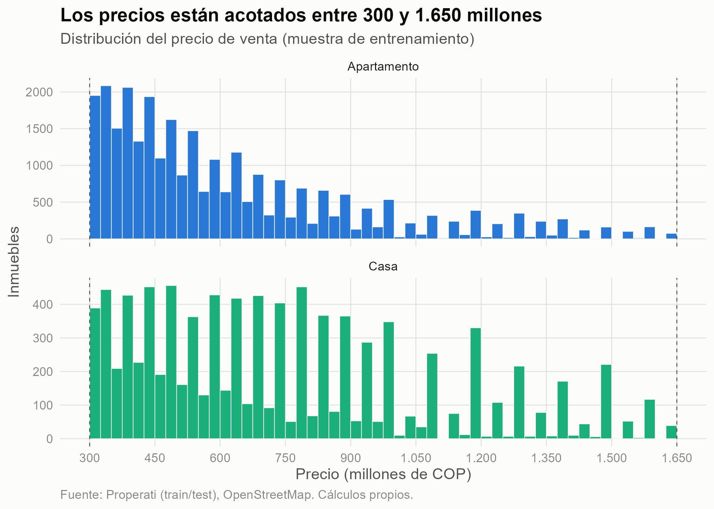
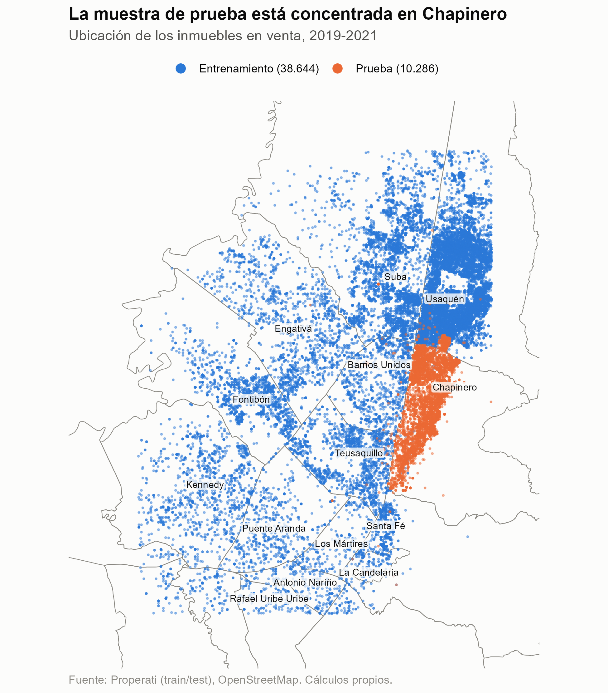
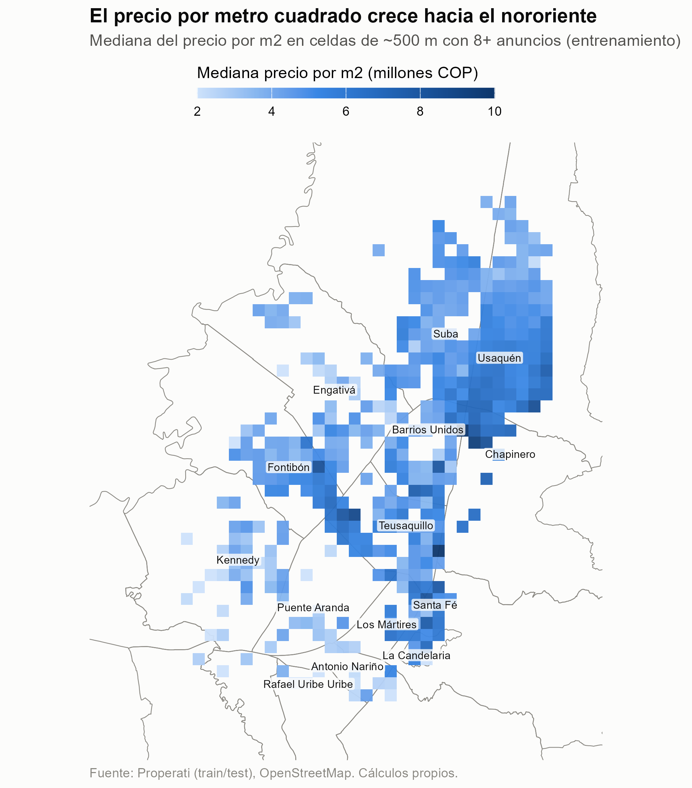
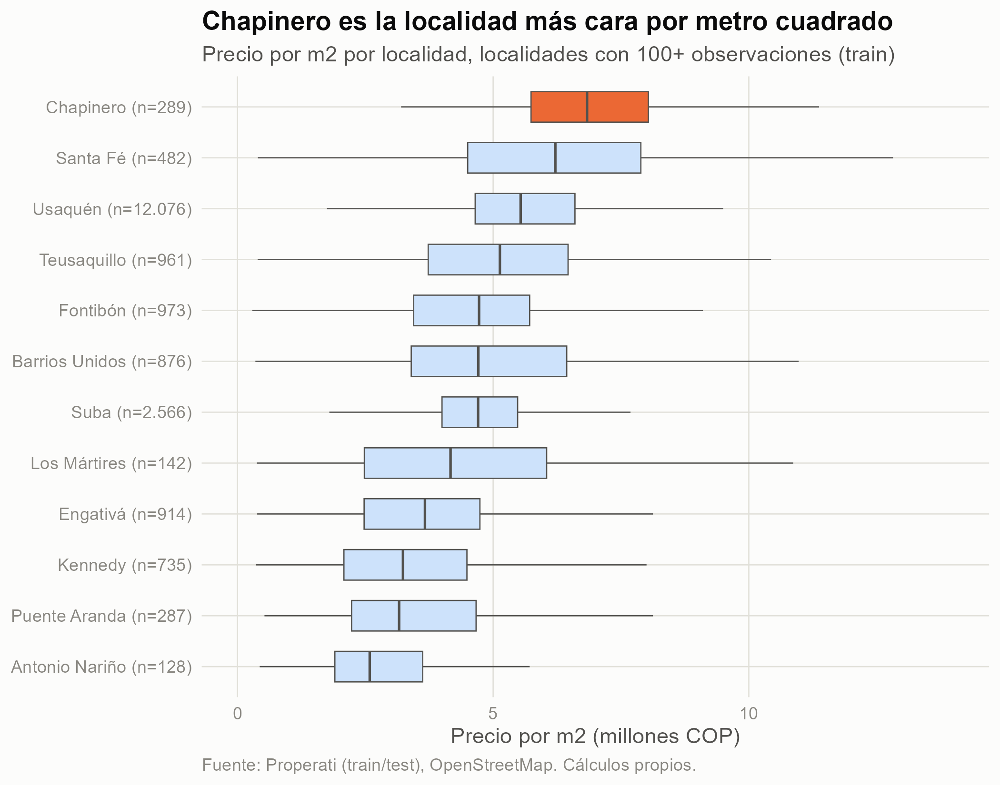
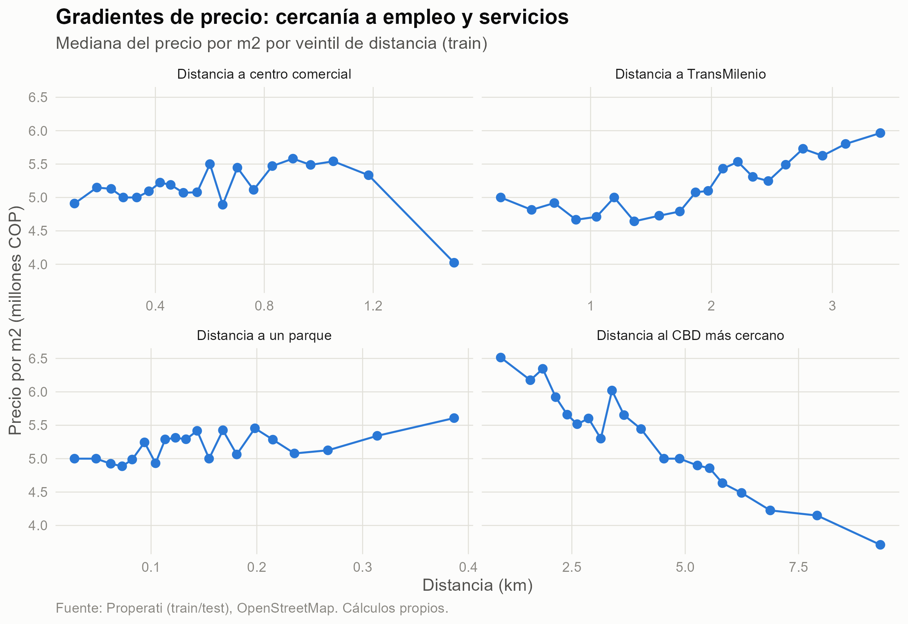
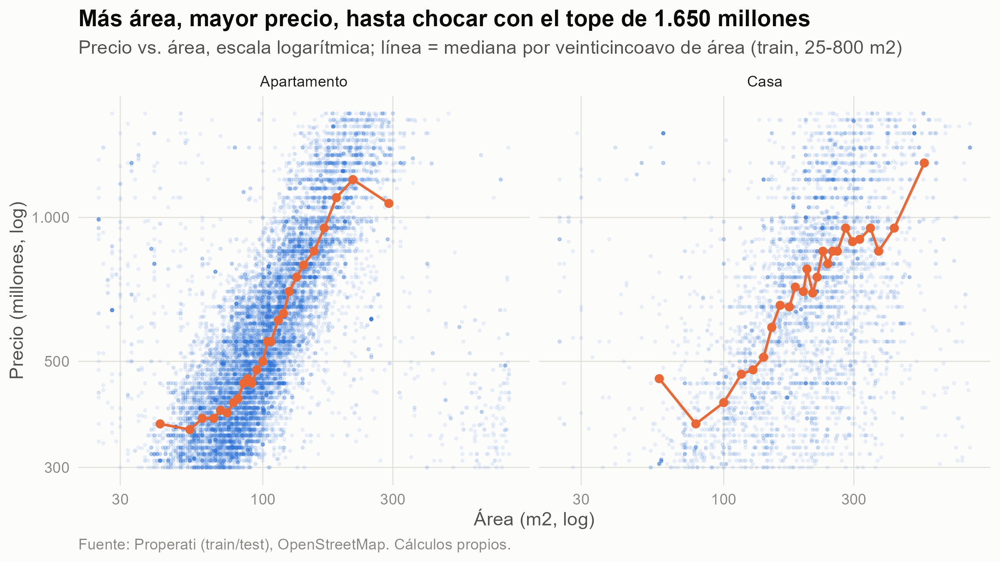
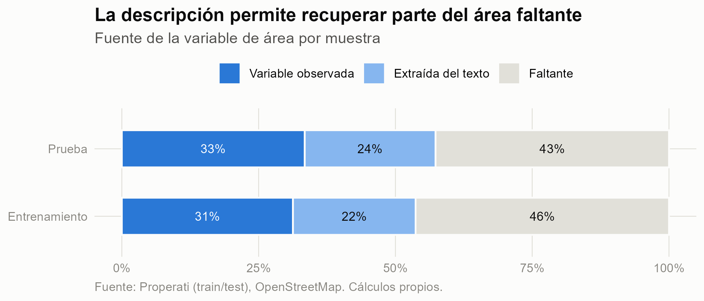
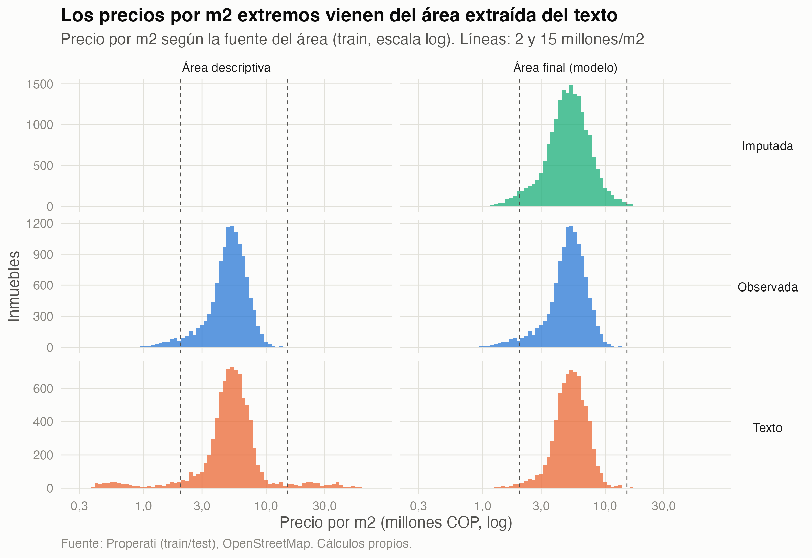
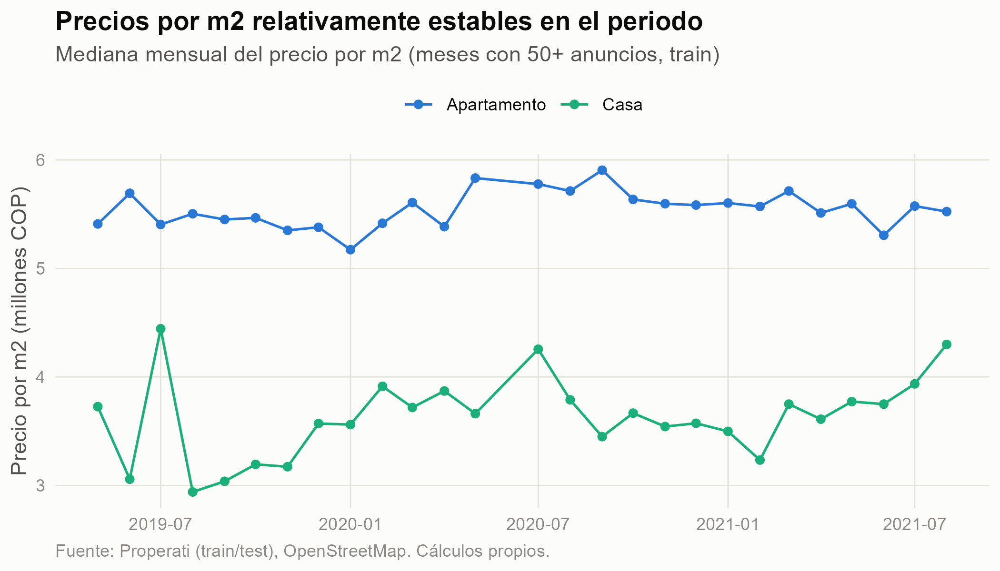
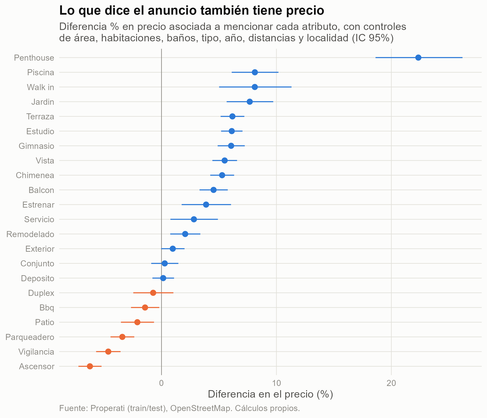

# Informe 1 — Estadísticas descriptivas y motivación espacial

**Problem Set 3: Predicting Prices · Big Data y Machine Learning · Uniandes 2026-2**
Código: [`scripts/02_descriptivas.R`](../../scripts/02_descriptivas.R) · Datos externos: [`scripts/01_osm_descarga.R`](../../scripts/01_osm_descarga.R)
Última actualización: 2026-11-16

---

## Resumen

1. **La muestra de prueba está concentrada en Chapinero**: 9.690 de las 10.286 observaciones (94%) están en esa localidad. En entrenamiento solo hay **307** de 38.644. El reto, por tanto, no es interpolar dentro de la ciudad sino **extrapolar a la zona más cara de Bogotá** con muy pocos ejemplos de ella.
2. **El precio está acotado entre 300 y 1.650 millones de COP** y se aglomera en cifras redondas. Las predicciones deben respetar ese soporte. No hay outliers de precio propiamente dichos: los extremos aparecen en el precio por m² y vienen de áreas mal extraídas del texto, que **perdió los puntos decimales** ("96.0 m2" se lee como "960 m2").
3. **El área, el predictor hedónico central, falta en el 69% de los anuncios**. Extrayéndola de la descripción se recupera cerca de un tercio de los faltantes.
4. **La ubicación pesa mucho**: el precio por m² cae alrededor de 7,5% por cada kilómetro de distancia al centro de empleo más cercano, y Chapinero tiene la mediana más alta de la ciudad (6,8 millones/m²).
5. **El texto del anuncio tiene información de precio** más allá de las variables estructurales: menciones como *penthouse*, *piscina*, *terraza* o *chimenea* se asocian a primas de 5% a 22% con controles.
6. Una regresión hedónica lineal con estos bloques alcanza un R² de 0,59, y varios signos contraintuitivos sugieren no linealidades e interacciones con la ubicación. Esto motiva usar modelos flexibles y **validación espacial**.

---

## 1. Datos

| | Entrenamiento | Prueba |
|---|---:|---:|
| Observaciones | 38.644 | 10.286 |
| Ciudad | Bogotá D.C. | Bogotá D.C. |
| Operación | Venta | Venta |
| Apartamentos | 75,5% | 97,3% |
| Periodo | abr-2019 a ago-2021 | abr-2019 a ago-2021 |

Las variables originales son: `price` (solo en train), `surface_total`, `surface_covered`, `rooms`, `bedrooms`, `bathrooms`, `property_type`, `lat`, `lon`, `month`, `year`, `title` y `description`. No hay identificadores duplicados, pero **8.078 descripciones del train están repetidas** (posibles anuncios republicados), algo a tener en cuenta al validar.

Las fuentes externas vienen de **OpenStreetMap** (API Overpass): límites de las 19 localidades urbanas y 111 UPZ, y la ubicación de 11 tipos de servicio (estaciones de TransMilenio, parques, centros comerciales, universidades, colegios, hospitales, restaurantes y bares, supermercados, policía, gimnasios y bancos). Con ellos se construyeron, para cada inmueble, la distancia al servicio más cercano y el número de servicios en un radio de 500 m.

## 2. La variable objetivo



| Estadístico | Valor (millones COP) |
|---|---:|
| Mínimo | 300 |
| Percentil 25 | 415 |
| Mediana | 560 |
| Media | 655 |
| Percentil 75 | 810 |
| Máximo | 1.650 |

- La distribución tiene **asimetría positiva** y está **truncada** en ambos extremos: nadie vende por menos de 300 ni por más de 1.650 millones. Lo más probable es que la muestra haya sido filtrada así.
- El **95,6% de los precios son múltiplos exactos de un millón**, y los valores más frecuentes son cifras redondas (450, 650, 550, 350 millones). Hay *heaping*.
- Las casas tienen una distribución más plana y desplazada a la derecha (mediana de 690 millones, frente a 530 de los apartamentos). Sin embargo, su precio por m² es menor (3,7 frente a 5,4 millones).

**Implicaciones:** modelar `log(precio)`, recortar las predicciones al intervalo [300, 1.650] millones y tener presente que, cerca de los topes, la relación entre atributos y precio se aplana.

## 3. El hallazgo central: entrenamiento y prueba viven en lugares distintos



| Localidad | n train | n test | Mediana precio (M) | Mediana precio/m² (M) |
|---|---:|---:|---:|---:|
| Usaquén | 21.461 | 506 | 590 | 5,54 |
| **Chapinero** | **307** | **9.690** | **750** | **6,84** |
| Suba | 5.109 | 16 | 550 | 4,71 |
| Teusaquillo | 2.074 | 19 | 600 | 5,13 |
| Fontibón | 1.842 | 0 | 510 | 4,72 |
| Engativá | 1.829 | 1 | 460 | 3,67 |
| Barrios Unidos | 1.699 | 37 | 620 | 4,71 |
| Kennedy | 1.517 | 0 | 420 | 3,24 |
| Santa Fe | 933 | 8 | 490 | 6,22 |
| Resto (9 localidades) | 1.873 | 9 | — | — |

Tabla completa: [`tables/localidades.csv`](tables/localidades.csv).

En el nivel de UPZ, el test se reparte en **Chicó Lago (4.286), El Refugio (3.432), Pardo Rubio (1.430) y Chapinero (495)**. En el train esas cuatro UPZ suman 307 observaciones. El texto lo confirma: "Rosales" aparece en el 15,3% de los anuncios del test y en el 0,2% de los del train, y "Chicó" en el 31% frente al 3,4%.

El perfil de los inmuebles de prueba también es distinto:

| Variable (media [mediana]) | Test | Train: Chapinero | Train: resto |
|---|---|---|---|
| Precio (millones) | — | 847 [750] | 653 [550] |
| Área (m²) | 134 [119] | 124 [110] | 149 [112] |
| Precio por m² (millones) | — | 7,07 [6,84] | 5,66 [5,15] |
| Habitaciones | 2,38 [2] | 2,39 [2] | 3,15 [3] |
| Baños | 2,70 [3] | 2,71 [3] | 2,85 [3] |
| Apartamento | 97% | 80% | 75% |
| Distancia al CBD más cercano (m) | 1.004 | 947 | 4.366 |
| Distancia a TransMilenio (m) | 1.331 | 1.466 | 1.830 |
| Restaurantes/bares a 500 m | 54,7 | 45,2 | 22,5 |
| Menciona chimenea | 30% | 30% | 23% |

Las 307 observaciones de Chapinero en el train se parecen mucho al test en sus atributos observables (habitaciones, baños, distancias), lo que las hace **la mejor aproximación disponible al conjunto de prueba**.

**Implicaciones para la modelación:**
- Una validación cruzada aleatoria **sobreestimará el desempeño**, porque evaluaría sobre todo en Usaquén, Suba y Kennedy. Se necesitan **folds espaciales** y una evaluación específica en las observaciones del train ubicadas en Chapinero.
- Variables categóricas como la localidad tienen poco poder para el test: el efecto fijo de Chapinero se estima con solo 307 datos. Las **variables continuas de ubicación** (distancias, densidad de servicios, coordenadas) se transfieren mejor.

## 4. Geografía del precio



El precio por m² dibuja el patrón conocido de Bogotá: crece hacia el **nororiente**, a lo largo del eje de los cerros orientales entre la Calle 26 y la Calle 127. Los valores más altos están en el límite entre Chapinero y Usaquén (zona del Parque 93, Chicó y El Retiro) y en algunos enclaves de Teusaquillo y Santa Fe (Centro Internacional, La Macarena). Los más bajos están en el suroccidente (Kennedy, Bosa, Ciudad Bolívar).



Chapinero es la localidad más cara por metro cuadrado (mediana de 6,8 millones) y tiene una dispersión amplia (rango intercuartílico de ~5,7 a 8,2). Le siguen Santa Fe (6,2) y Usaquén (5,5). En el otro extremo, Antonio Nariño, Puente Aranda y Kennedy tienen medianas de 2,6 a 3,2 millones por m².

## 5. Gradientes de distancia



- **Distancia al centro de empleo (CBD):** es el gradiente más limpio y monótono, coherente con el modelo monocéntrico (Alonso-Muth-Mills). Se definieron tres polos: Centro Internacional, Calle 72 y Parque de la 93. El precio por m² pasa de ~6,5 millones a menos de 1 km de un polo a ~3,7 millones a 9 km. La correlación con `log(precio)` es de −0,29.
- **Distancia a TransMilenio:** el gradiente es *positivo* (más lejos, más caro). No es que el transporte reste valor, sino que las troncales recorren corredores de ingreso medio y bajo, mientras que la zona más rica del nororiente está relativamente lejos de ellas. Es un ejemplo de **confusión espacial**: el efecto causal del transporte no se identifica con una correlación simple.
- **Parques y centros comerciales:** gradientes débiles. Casi todos los inmuebles tienen un parque a menos de 400 m (la mediana es 137 m), así que hay poca variación útil. La densidad de parques grandes podría informar más.

## 6. Atributos estructurales y datos faltantes



| Variable | % faltante (train) | % faltante (test) |
|---|---:|---:|
| Área, variable original (`surface_covered` o `surface_total`, 20–1.500 m²) | 68,7% | 66,6% |
| **Área tras extraerla del texto** | **46,3%** | **42,7%** |
| Baños, variable original | 26,1% | 24,2% |
| **Baños tras extraerlos del texto** | **17,5%** | **16,1%** |
| `rooms` | 47,3% | 44,5% |
| `bedrooms` | 0% | 0% |
| Estrato mencionado en el texto | 7,7% disponible | 5,8% disponible |



- **Área.** Es el atributo hedónico central y su relación con el precio es casi lineal en logaritmos para apartamentos de 40 a 250 m². Se aplana después por el tope de 1.650 millones. La extracción del texto usa expresiones regulares (por ejemplo, "120 m2", "85 mts", "200 metros") y se limita a valores entre 20 y 1.000 m². **Advertencia:** la extracción es ruidosa (a veces captura el área de una terraza o del lote) y conviene contrastarla con habitaciones y baños antes de usarla sin filtro.
- **Baños** es la variable con mayor correlación simple con el log del precio (0,56). Captura a la vez tamaño y calidad.
- **`rooms` y `bedrooms`** tienen una correlación de 0,99. `rooms` no aporta información adicional y se descarta.
- **Estrato.** Es una variable clave en la literatura colombiana y su correlación con el log del precio es 0,29, pero solo aparece en ~7% de los anuncios. Una alternativa es imputarlo con la manzana catastral (datos abiertos de Bogotá).

Correlaciones simples con `log(precio)` en el train: baños 0,56 · área 0,35 · estrato 0,29 · habitaciones 0,24 · distancia a TransMilenio 0,15 · distancia al Parque 93 −0,28 · distancia al CBD −0,29.

## 7. Valores extremos y rangos de validez

Código: [`scripts/02b_extremos.R`](../../scripts/02b_extremos.R). Tablas: `rangos_validez.csv`, `precio_topes.csv` y `precio_m2_extremos.csv`.

### 7.1 Por qué se usan esos rangos

Los rangos se fijaron por plausibilidad física: un apartaestudio pequeño tiene unos 20 m², el estrato va de 1 a 6 por definición, y así con las demás variables. La tabla muestra qué valores caen fuera de cada rango. En casi todas las variables son errores evidentes y pocos, así que el rango exacto importa poco. La excepción es el área extraída del texto.

| Variable | Rango | Fuera (bajo / sobre) | Valores fuera más frecuentes | Lectura |
|---|---|---:|---|---|
| Área, variable original | [20, 1.500] | 8 / 5 | 2, 6, 7, 7.700 | Errores de digitación |
| **Área del texto** | [20, 1.000] | **391 / 2.391** | 10–19; 8.144, 9.620 | Por debajo de 20: terrazas, balcones o depósitos. Por encima de 1.000: **decimales perdidos** (ver abajo) |
| Baños del texto | [1, 8] | 6 / 6 | 0, 9 | Errores |
| `bathrooms` original | *sin filtro* | 0 / 55 | 9–13 | No se filtra (posibles casas grandes) |
| Estrato del texto | [1, 6] | 0 / 0 | — | Definición legal |
| Piso del texto | [1, 40] | 0 / 148 | 77, 98, 42 | Pocos edificios residenciales de Bogotá pasan de 40 pisos. Los valores altos no parecen ser pisos |
| Antigüedad del texto | [0, 60] | 0 / 6 | 79, 94, 95 | Probablemente años de construcción ("del 94") |
| Parqueaderos del texto | [1, 6] | 104 / 143 | 0, 7, 8 | La regex no tiene límite de palabra: en "10 parqueaderos de visitantes" lee el 0 |
| `bedrooms` | *sin filtro* | 186 en 0 / 97 en 11 | 0, 11 | El 0 aparece en anuncios genéricos ("casa en en bogota") y 11 parece ser el tope del dato |

**El texto perdió los puntos decimales.** En los títulos con formato "N habitaciones M m2", 121 de 396 tienen N = 10 × `bedrooms`. Por ejemplo, "apartamento en tarragona 30 habitaciones 1500 m2" corresponde a 3 habitaciones y 150,0 m². En las descripciones pasa lo mismo: "8144 mts" es 81,44 m². En consecuencia:

- Casi todas las áreas de texto mayores de 1.000 son áreas legítimas multiplicadas por 10 o por 100, y hoy se descartan.
- Las áreas infladas que quedan por debajo de 1.000 ("960 m2" por 96,0) pasan el filtro de rango. En la modelación las atrapa la regla de coherencia de D3, que acepta el área del texto solo si está entre 0,5 y 2 veces la predicción del random forest.

### 7.2 Extremos del precio



| | Chapinero | Resto | Total |
|---|---:|---:|---:|
| n | 307 | 38.337 | 38.644 |
| Exactamente 300 M | 2 | 507 | 509 (1,3%) |
| ≤ 310 M | 1,6% | 3,0% | 3,0% |
| Exactamente 1.650 M | 3 | 103 | 106 (0,3%) |
| **≥ 1.600 M** | **3,3%** | 0,9% | 0,9% |
| Múltiplos de 10 M | 81% | 78% | 78% |
| Múltiplos de 50 M | 44% | 34% | 34% |

- **El precio no tiene outliers propiamente dichos: está acotado.** La masa en los topes es pequeña, y el valor exacto de 300 M (509 casos) es menos frecuente que otras cifras redondas, como 450 M (1.020) o 350 M (808). Eso se parece más a una muestra filtrada con *heaping* que a precios censurados y amontonados en el tope. Los inmuebles de 300 M son más pequeños (mediana de 70 m² frente a 113), lo que es coherente con su precio.
- **El tope superior pesa más en Chapinero**: el 3,3% de sus precios están en 1.600 M o más, frente al 0,9% del resto. En la zona del test, el filtro de 1.650 M excluye una parte mayor de la distribución, y por eso recortar las predicciones a 1.650 M es aún más importante ahí.
- **Precios psicológicos:** hay 1.097 inmuebles entre 950 y 1.000 M y solo 318 entre 1.000 y 1.050 M. Los vendedores evitan cruzar los mil millones.
- **Los extremos relativos están en el precio por m², y vienen del área, no del precio.** Con el área de las descriptivas (observada o, si falta, la del texto sin filtrar), el rango p1–p99 del precio por m² de los apartamentos es 3,2–9,8 M/m² cuando el área es observada, pero 0,5–37,7 M/m² cuando viene del texto. Entre el 11% y el 12% de los anuncios con área del texto tienen un z robusto de |z| > 3 en log(precio/m²), frente al 0,5% de los anuncios con área observada. Con el área final de la modelación, el p99 del texto baja a 10,8 M/m² y la proporción con |z| > 3 cae al 0,8%: la regla de coherencia funciona.

**Implicaciones:**

1. No hace falta eliminar observaciones por precio extremo.
2. El área final de modelación es razonablemente limpia.
3. Se puede recuperar parte del área del texto corrigiendo los decimales perdidos (pendiente).
4. Las figuras 2, 4, 5 y 9 usan el área de las descriptivas. Como reportan medianas, son robustas a esas colas, pero cualquier *media* del precio por m² calculada con esa área estaría sesgada.

## 8. Evolución temporal



El precio por m² de los apartamentos se mantiene estable en el periodo (5,2–5,9 millones). El de las casas es más volátil por el menor número de observaciones mensuales. No se observa un choque visible asociado a la pandemia de 2020; si hubo uno, coincide con la caída en el número de anuncios (no hay datos de junio de 2020). El año y el mes entran como controles menores.

## 9. El texto del anuncio como fuente de información

La descripción contiene atributos que no están en las variables estructuradas. Se construyeron 22 indicadores de mención y se estimaron sus primas en una regresión hedónica que controla por área, habitaciones, baños, tipo de inmueble, año, distancias y localidad:



| Atributo | Prima estimada | Interpretación |
|---|---:|---|
| Penthouse | +22% | Piso alto, terraza, exclusividad |
| Piscina | +8% | Amenidad de conjunto de lujo |
| Walk-in closet | +8% | Señal de acabados de gama alta |
| Jardín | +8% | Espacio exterior privado |
| Terraza / estudio / gimnasio | +6% | Espacios adicionales |
| Vista / chimenea | +5% | Atributos típicos del nororiente |
| Remodelado / para estrenar | +2–4% | Estado de conservación |
| Ascensor / vigilancia / parqueadero | −3% a −7% | Probable confusión: edificios grandes y densos, conjuntos de estrato medio |

Las primas negativas no deben leerse como causales. Probablemente capturan el tipo de edificio (torres de muchos apartamentos pequeños frente a edificios boutique) que las variables de ubicación no logran controlar. Para un modelo predictivo esto no es un problema; para la interpretación, sí.

## 10. Regresión hedónica de referencia

Variable dependiente: `log(precio)`. Muestra: train con área y baños observados (n = 18.135). Tabla completa en LaTeX: [`tables/hedonica_motivacional.tex`](tables/hedonica_motivacional.tex).

| | (1) Estructural | (2) + Ubicación | (3) + Texto | (4) + EF localidad |
|---|---:|---:|---:|---:|
| log(área) | 0,314*** | 0,283*** | 0,272*** | 0,271*** |
| Habitaciones | −0,067*** | −0,033*** | −0,023*** | −0,011*** |
| Baños | 0,204*** | 0,175*** | 0,155*** | 0,149*** |
| Apartamento | 0,041*** | −0,059*** | −0,093*** | −0,114*** |
| Distancia CBD (km) | | −0,064*** | −0,066*** | −0,075*** |
| Distancia TransMilenio (km) | | 0,047*** | 0,043*** | 0,020*** |
| Distancia parque (100 m) | | 0,007*** | 0,005** | 0,007*** |
| log(1 + restaurantes 500 m) | | −0,025*** | −0,022*** | −0,021*** |
| 22 indicadores de texto | | | Sí | Sí |
| EF de año | Sí | Sí | Sí | Sí |
| EF de localidad | No | No | No | Sí |
| **R²** | **0,443** | **0,534** | **0,572** | **0,587** |

Lectura:
- La **elasticidad precio-área de ~0,27** es baja frente a la literatura (normalmente entre 0,6 y 0,9). Hay dos explicaciones: el truncamiento del precio aplana la relación, y el error de medida en el área (mezcla de área construida, total y extraída del texto) produce sesgo de atenuación. Con habitaciones y baños en el modelo, parte del efecto del tamaño se reparte entre ellas.
- El coeficiente negativo de **habitaciones**, condicional al área, es el resultado estándar: con el área fija, más habitaciones significa espacios más pequeños.
- Agregar la ubicación sube el R² en 9 puntos. El texto suma 4 y los efectos fijos de localidad apenas 1,5 más, lo que indica que las distancias continuas ya capturan buena parte de la geografía.

## 11. Implicaciones para la etapa de modelación

| Hallazgo | Decisión |
|---|---|
| Test ≈ Chapinero, casi ausente en el train | Validación cruzada **espacial por bloques**, más una evaluación específica en las 307 observaciones del train en Chapinero |
| Precio truncado [300, 1.650] M y asimétrico | Modelar `log(precio)` y recortar las predicciones al soporte |
| Área faltante en 46% aun con el texto | Imputar el área con un modelo (habitaciones, baños, tipo, ubicación, texto) y agregar indicadores de imputación |
| Signos contraintuitivos por confusión espacial | Modelos no lineales con interacciones (random forest, boosting) además de la regresión penalizada |
| El texto aporta información de precio | Indicadores de amenidades; más adelante, bolsa de palabras o TF-IDF con regularización |
| `rooms` redundante | Descartar `rooms`; usar `bedrooms` |
| Precio acotado, sin outliers propios. Los extremos del precio por m² vienen del área del texto (decimales perdidos) | No eliminar observaciones. Regla de coherencia para el área del texto (D3); pendiente: recuperar los decimales |
| Métrica de la competencia: MAE (supuesto, por confirmar en Kaggle) | Predecir la mediana condicional: `exp(log)` es una buena aproximación |

---

### Reproducibilidad

```bash
Rscript scripts/01_osm_descarga.R   # descarga OSM (usa caché si ya existe)
Rscript scripts/02_descriptivas.R   # genera figuras, tablas y data/processed/base_enriquecida.csv
Rscript scripts/02b_extremos.R      # valores extremos (requiere también base_modelo.rds de 03_features.R)
```

Restricción del entorno: Windows (Control de aplicaciones) bloquea las librerías `sf`, `units` y `geosphere`. Las operaciones espaciales se implementaron con `sp::point.in.polygon` y una función haversine propia.
