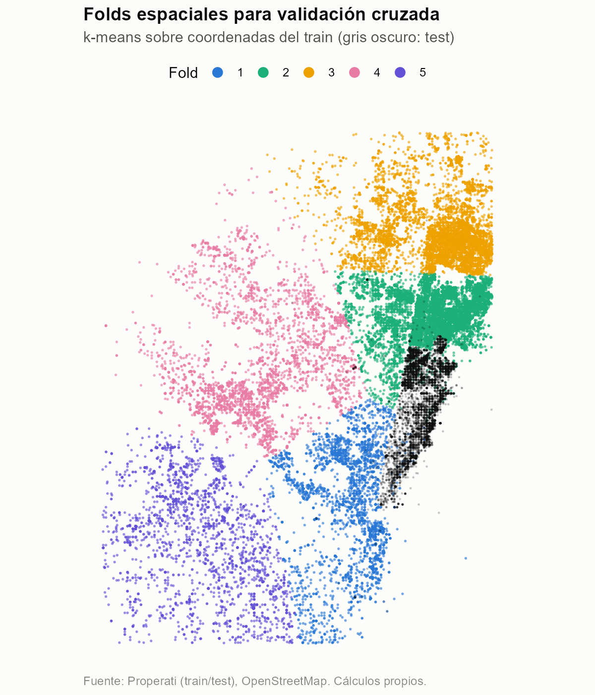
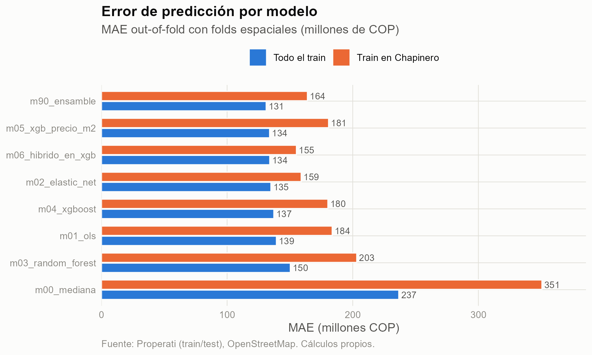
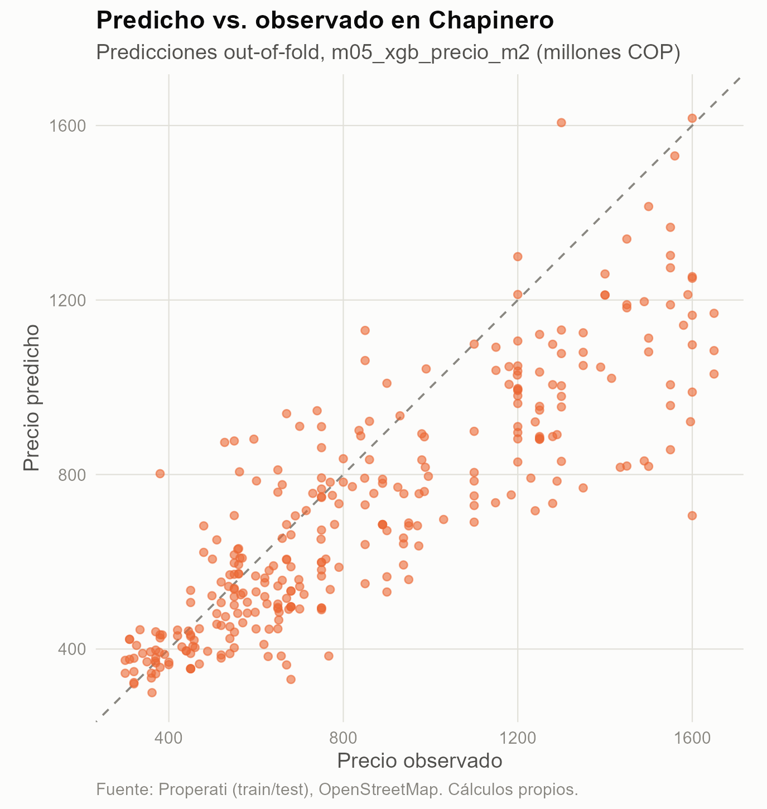

# Informe 2 — Modelación: primera ronda

**Problem Set 3: Predicting Prices · Big Data y Machine Learning · Uniandes 2026-2**
Código: [`scripts/03_features.R`](../../scripts/03_features.R) → [`04`](../../scripts/04_regresiones.R) · [`04b`](../../scripts/04b_elastic_net.R) · [`05`](../../scripts/05_random_forest.R) · [`06`](../../scripts/06_xgboost.R) · [`07`](../../scripts/07_hibridos.R) → [`90_comparacion.R`](../../scripts/90_comparacion.R)
Registro de métricas: [`models/registro_modelos.csv`](../../models/registro_modelos.csv) · Última actualización: 2026-11-14

---

## Resumen

- Se estimaron siete modelos más un ensamble, evaluados con **validación cruzada espacial** (5 bloques). Además del MAE total se mide el error en las **307 observaciones del train ubicadas en Chapinero**, la mejor aproximación al test.
- **Los árboles puros no extrapolan hacia Chapinero.** El random forest tiene un MAE de 203 millones en Chapinero y XGBoost de 180, frente a 159 del elastic net. Chapinero es más caro que casi todo el train, y un árbol no puede predecir por encima de los valores que vio en zonas parecidas. Un modelo lineal, en cambio, extrapola por los gradientes (área × estrato, distancia al CBD).
- Los mejores modelos combinan ambas ideas:
  - **m06, híbrido lasso + XGBoost en residuos**: mejor MAE en Chapinero (**155 millones**, MAPE de 17,6%).
  - **m05, XGBoost sobre el precio por m²**: mejor modelo individual en el total (**134 millones**).
  - **m90, ensamble**: mejor MAE total (**131 millones**), pero 164 en Chapinero.
- Todos los modelos **subpredicen Chapinero**: el sesgo medio de m05 es de −135 millones. Corregir ese sesgo es la principal oportunidad de mejora.

## 1. Diseño de la validación

- **Folds:** k-means (k = 5) sobre las coordenadas en km del train. Los bloques son contiguos, así que el modelo siempre predice zonas que no vio al entrenar.
- **Métricas** (MAE en pesos, sobre predicciones *out-of-fold*, recortadas a [300, 1.650] millones):
  - `mae_total`: todo el train.
  - `mae_chapinero`: las 307 observaciones del train en Chapinero (246 en el fold 2 y 61 en el fold 1). **Es la métrica más relevante para el test, aunque ruidosa**: con n = 307, su error estándar es de unos ±8–10 millones.
  - `mae_fold2`: el bloque de Usaquén y Chapinero (16.492 obs), el más parecido al test.
- **Variable objetivo:** `log(precio)`. La predicción es `exp(ŷ)` recortada al soporte. Ver [D2](../../docs/decisiones.md).
- **Variables:** 66 (69 en la versión para árboles, con indicadores de faltante): área imputada (R² OOB 0,83), baños, estrato imputado espacialmente (R² OOB 0,79), piso, antigüedad y parqueaderos del texto, 22 indicadores de amenidades, coordenadas (también rotadas), distancias y densidades de servicios de OSM. Diccionario en [`docs/guia_variables.md`](../../docs/guia_variables.md).

## 2. Resultados

| Modelo | Descripción | MAE total (M) | MAE Chapinero (M) | MAPE Chapinero | MAE fold 2 (M) |
|---|---|---:|---:|---:|---:|
| m00 | Mediana (referencia) | 236,7 | 350,6 | 35,8% | 278,4 |
| m01 | OLS | 139,3 | 183,7 | 20,7% | 145,7 |
| m02 | Elastic net (lasso, α=1) | 134,9 | 159,0 | 17,8% | 147,3 |
| m03 | Random forest | 150,3 | 203,2 | 21,7% | 155,2 |
| m04 | XGBoost | 137,2 | 180,2 | 20,0% | 145,3 |
| m05 | XGBoost sobre precio/m² | **133,8** | 180,8 | 19,7% | **143,3** |
| m06 | Híbrido lasso + XGBoost en residuos | 134,0 | **155,2** | **17,6%** | 148,0 |
| m90 | Ensamble ponderado | *131,1* | 163,9 | — | *141,6* |

*El MAE del ensamble está en cursiva porque es levemente optimista: los pesos se eligieron con las mismas predicciones OOF.*

### 2.1 Elastic net (m02)
- Grilla α ∈ {0; 0,25; 0,5; 0,75; 1} con λ por CV espacial (`cv.glmnet` con `foldid`). La diferencia entre valores de α es pequeña (135–141 millones). Gana el **lasso** (α = 1, λ = 0,005), que conserva 41 de 89 coeficientes.
- La matriz incluye términos cuadráticos, las interacciones área × estrato, área × apartamento y CBD × apartamento, y dummies de localidad.
- Los coeficientes estandarizados más grandes son: log(área), **log(área) × estrato**, baños, habitaciones² (negativo) y distancia a la Calle 72 (negativa). La interacción con el estrato es lo que permite extrapolar: el valor de un m² adicional crece con el nivel socioeconómico.
- Tabla: [`tables/elastic_net_coeficientes.csv`](tables/elastic_net_coeficientes.csv).

### 2.2 Random forest (m03)
- Grilla mtry ∈ {10, 20, 35} × min.node.size ∈ {3, 10}, con 300 árboles. Gana mtry = 35 (casi la mitad de las variables) y el modelo final usa 800 árboles. Un mtry mayor ayuda porque obliga a usar el área y el estrato en casi todos los cortes.
- Es el peor modelo en Chapinero. Las hojas promedian precios de vecinos más baratos y el bosque comprime las predicciones hacia la media.

### 2.3 XGBoost (m04) y XGBoost sobre precio por m² (m05)
- Grilla max_depth ∈ {4, 6, 8} × min_child_weight ∈ {3, 10}, η = 0,03, subsample 0,8, colsample 0,6, con early stopping usando los folds espaciales. Gana **depth = 4, mcw = 10** (745 rondas). Los árboles poco profundos generalizan mejor entre zonas.
- **m05** cambia la variable objetivo a `log(precio) − log(área)`. El árbol aprende el *nivel* de precio por m² de cada ubicación y el área entra de forma multiplicativa, lo que elimina la necesidad de aprender la curva precio-área con escalones. Mejora el MAE total (133,8) y el del fold 2 (143,3), pero no el de Chapinero: el problema de nivel persiste.

Importancia (ganancia, m04): log(área) 45%, baños 16%, estrato 10%, distancia a la Calle 72 6%. Siguen las distancias al Parque 93 y al CBD, los parqueaderos y las coordenadas.

### 2.4 Híbrido lasso + XGBoost (m06)
- El lasso da la predicción base (`base_margin`) y XGBoost aprende solo los residuos.
- **Validación anidada:** en cada fold externo el lasso se reajusta, y su margen para las filas de entrenamiento es *out-of-fold* interno. Así XGBoost no aprende de residuos "demasiado buenos".
- El early stopping se detiene en solo 35 rondas: XGBoost hace correcciones pequeñas sobre la tendencia lineal. Con eso basta para tener el mejor error en Chapinero (155,2), sin perder en el total (134,0).

### 2.5 Ensamble (m90)
- Pesos no negativos que suman 1 sobre las predicciones en log, elegidos en una grilla para minimizar el MAE OOF total: **m05 0,45 · m06 0,35 · m02 0,15 · m01 0,05**. El random forest y m04 reciben peso 0.
- Mejora el total y el fold 2, pero empeora Chapinero frente a m06, porque los pesos se optimizaron para toda la ciudad.

## 3. Diagnóstico: dónde y cómo se equivoca

| Localidad | n | MAE (M) | Sesgo medio (M) | MAPE |
|---|---:|---:|---:|---:|
| Chapinero | 307 | 180,8 | **−134,6** | 19,7% |
| La Candelaria | 178 | 234,3 | −76,9 | 32,4% |
| Barrios Unidos | 1.699 | 180,9 | −35,3 | 26,9% |
| Usaquén | 21.461 | 127,4 | −18,7 | 18,5% |
| Suba | 5.109 | 123,7 | −19,8 | 18,2% |
| Kennedy | 1.517 | 120,6 | −4,6 | 23,5% |

(Modelo m05, predicciones OOF. Tabla completa en [`tables/error_por_localidad.csv`](tables/error_por_localidad.csv).)

- En Chapinero el modelo **subpredice de forma sistemática**, sobre todo los inmuebles de más de 1.000 millones: la nube de puntos queda debajo de la diagonal. Es el patrón de *regresión a la media* que se espera cuando una zona cara se predice con información de zonas más baratas.
- En MAPE, Chapinero (19,7%) no es peor que Usaquén. El MAE es alto porque los precios son altos, no porque el modelo entienda peor la zona; el problema es de **nivel (sesgo)**, no de dispersión.

## 4. Recomendación para Kaggle

| Prioridad | Archivo | Por qué |
|---|---|---|
| 1 | [`submissions/m06_hibrido_en_xgb.csv`](../../submissions/m06_hibrido_en_xgb.csv) | Mejor MAE en Chapinero, la métrica más parecida al test |
| 2 | [`submissions/m90_ensamble.csv`](../../submissions/m90_ensamble.csv) | Mejor MAE total; sirve para comparar en el leaderboard público |
| 3 | [`submissions/m02_elastic_net.csv`](../../submissions/m02_elastic_net.csv) | Modelo simple y robusto, como referencia |

El leaderboard público es la única evaluación directa sobre Chapinero. Comparar m06 contra m90 dirá si la métrica de Chapinero del train es una buena guía.

## 5. Siguientes pasos (por impacto esperado)

1. **Corregir el sesgo en Chapinero.**
   - *Pesos por cambio de covariables:* entrenar un clasificador test-vs-train y ponderar el train por `p/(1−p)`, para que el modelo se concentre en inmuebles parecidos a los del test.
   - Calibrar el nivel con las 307 observaciones de Chapinero (por ejemplo, un intercepto por zona estimado con contracción).
2. **Rezago espacial del precio:** mediana del log del precio por m² de los k vecinos más cercanos del train, calculada dentro de cada fold para evitar fuga. En el test, los vecinos más cercanos de Chapinero sí incluyen las 307 observaciones de la zona.
3. **Duplicados train-test:** 200 anuncios del test tienen una descripción idéntica en el train (117 con la misma ubicación), y el 80% de los duplicados internos del train tiene el mismo precio. *Hay que confirmar que las reglas del curso permiten explotarlo.*
4. **Texto más rico:** TF-IDF de uni- y bigramas con lasso, o *embeddings*.
5. **Datos externos de mejor calidad:** estrato por manzana y avalúo catastral (Datos Abiertos Bogotá), y completar las estaciones de TransMilenio en OSM (solo hay 61 de ~140 etiquetadas).
6. Afinar los hiperparámetros del híbrido (profundidad, η, número de rondas) y probar `reg:absoluteerror` como objetivo, ya que la métrica es MAE.
