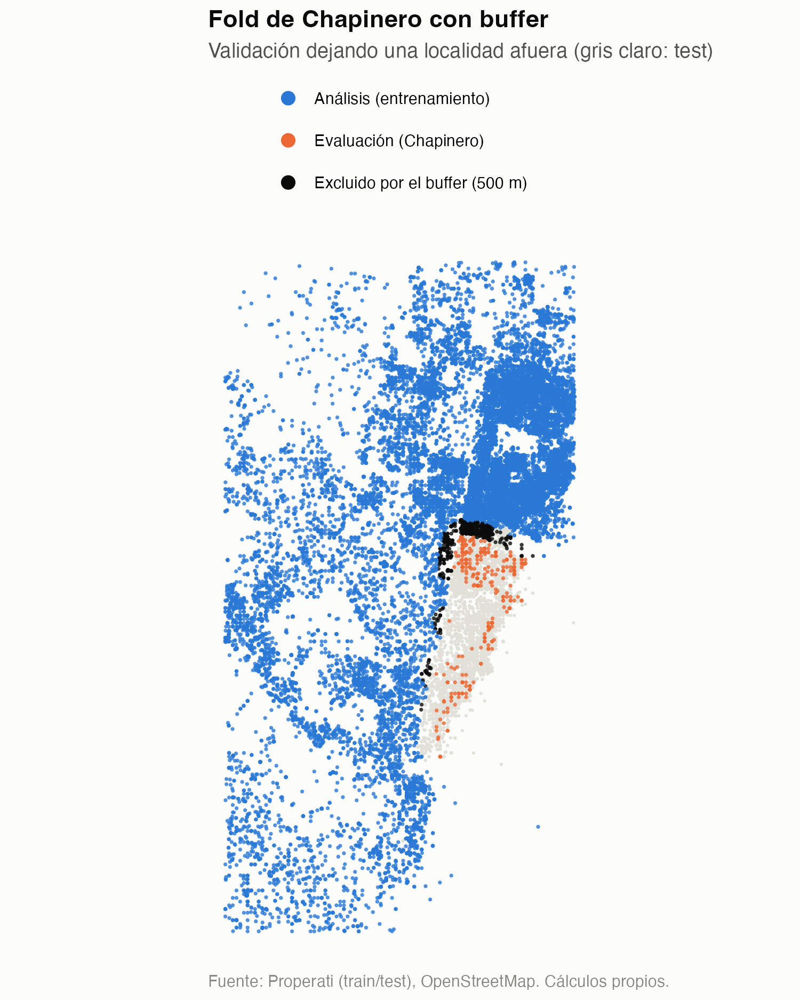
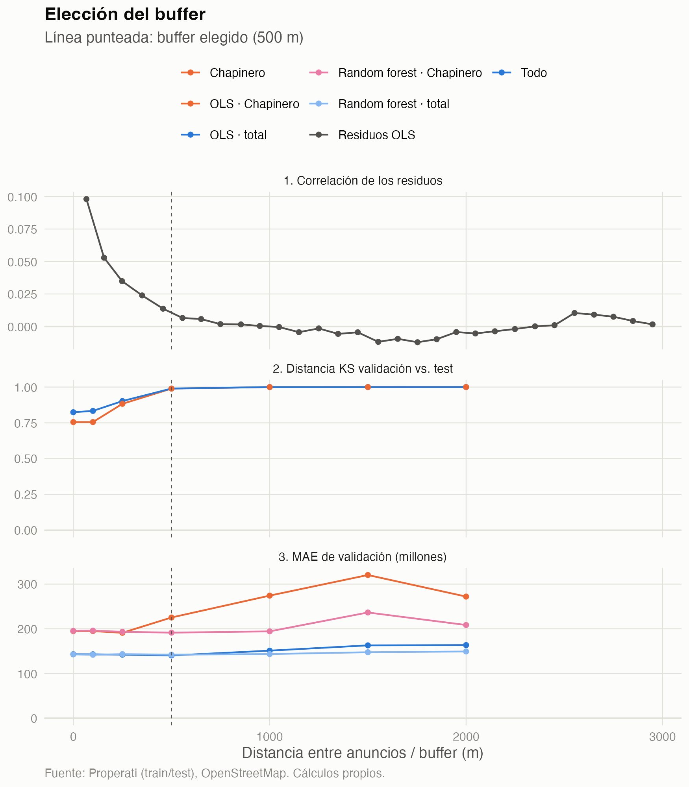
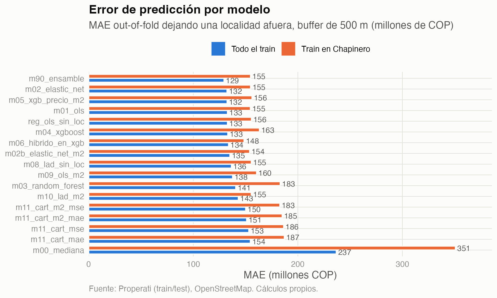
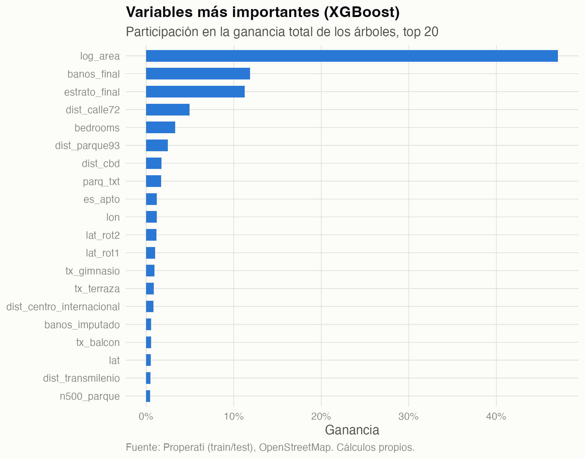
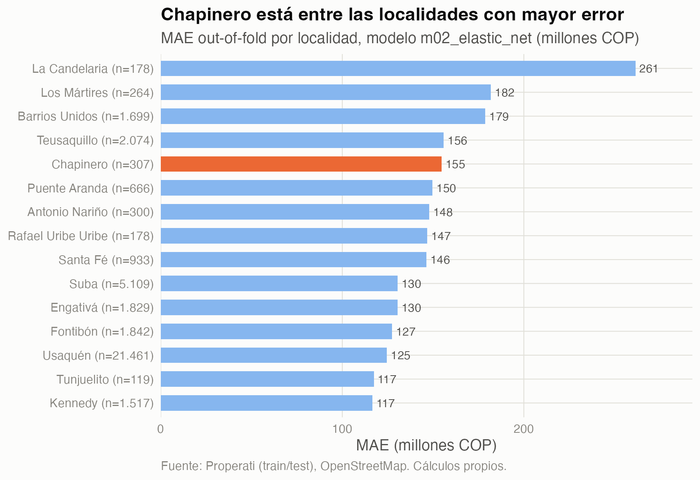
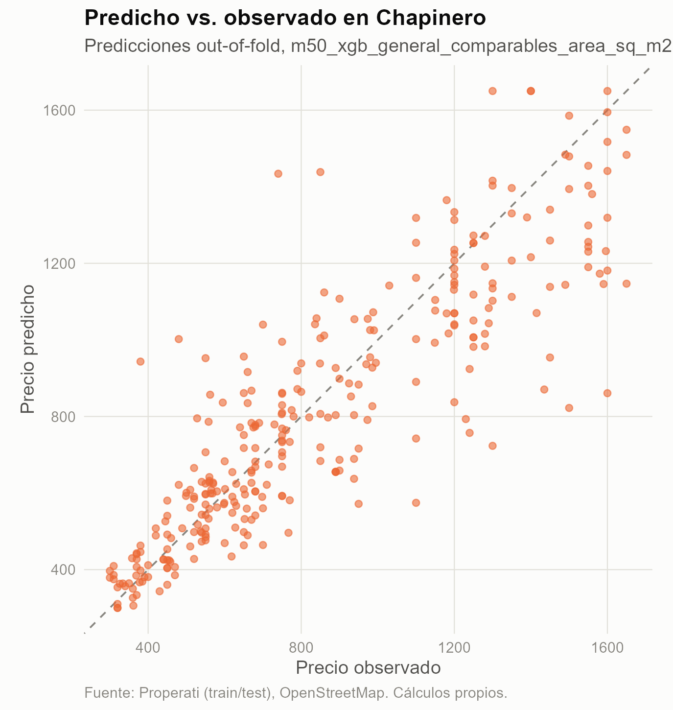

# Informe 2 — Modelación: segunda ronda (validación por localidad con buffer)

**Problem Set 3: Predicting Prices · Big Data y Machine Learning · Uniandes 2026-2**
Código: [`code/03_features.R`](../../code/03_features.R) · [`03b_buffer.R`](../../code/03b_buffer.R) → [`04`](../../code/04_regresiones.R) · [`04b`](../../code/04b_elastic_net.R) · [`05`](../../code/05_random_forest.R) · [`06`](../../code/06_xgboost.R) · [`07`](../../code/07_hibridos.R) → [`90_comparacion.R`](../../code/90_comparacion.R)
Registro de métricas: [`models/registro_modelos.csv`](../../models/registro_modelos.csv) · Última actualización: 2026-11-18

---

## Resumen

- **Nueva validación:** se deja afuera una localidad a la vez (18 folds), con un **buffer de 500 m**, y todos los modelos usan la misma función `cv_oof()` ([D9](../../docs/decisiones.md)). Los resultados no son comparables con la primera ronda (k-means), que quedó archivada en `models/registro_modelos_kmeans.csv`.
- **Ningún modelo lleva dummies de localidad** ([D10](../../docs/decisiones.md)). La dummy de la localidad evaluada no se puede estimar, y quitarlas baja el MAE del OLS en Chapinero de 225 a 155 millones.
- **Mejor modelo para el test: m06, híbrido lasso + XGBoost en residuos**, con **148,5 millones** de MAE en Chapinero. Le gana en Chapinero al elastic net (−6,3 M, *t* pareado = −4,3) y al OLS (−7,1 M, *t* = −4,3), y pierde solo 1–2 M en el total.
- Los modelos lineales sin dummies quedan muy cerca entre sí: entre 154 y 156 M en Chapinero y alrededor de 132 M en el total. Predecir por m² empeora el total (135 M con elastic net), aunque con penalización empata en Chapinero (153,8 M).
- Los árboles puros siguen sin extrapolar hacia Chapinero (random forest: 183 M; XGBoost: 163 M).

## 1. Diseño de la validación

- **Folds:** cada localidad del train es un fold de evaluación. Del entrenamiento se excluyen los anuncios a menos de 500 m de algún anuncio evaluado. Equivale a `spatialsample::spatial_leave_location_out_cv()` con `buffer`, implementado con una haversine propia en [`utils_modelos.R`](../../code/utils_modelos.R). [`check_validacion.R`](../../code/exploratorio/check_validacion.R) verifica la partición, el buffer y `cv_oof()`.
- **Hiperparámetros:** `cv.glmnet(foldid=)` y `xgb.cv()` no admiten buffer. λ y el número de rondas se eligen por MAE OOF mínimo sobre una grilla, con `cv_oof()`, `xgb_rondas()` y `mejor_columna()`.
- **Métricas** (MAE en pesos, sobre predicciones *out-of-fold* recortadas a [300, 1.650] millones):
  - `mae_total`: todo el train.
  - `mae_chapinero`: las 307 observaciones del train en Chapinero, cuando Chapinero es el fold evaluado. **Es la métrica más relevante para el test** (D7). Su error estándar es de ±8 M, pero las comparaciones *pareadas* entre modelos son mucho más precisas (±1–4 M).
  - `mae_macro`: el promedio simple del MAE de las localidades, para que Usaquén (55% del train) no domine.
- **Semillas:** 123 en todo el proyecto.

### 1.1 Elección del buffer

| Criterio | Resultado | Implicación |
|---|---|---|
| Autocorrelación de los residuos (OLS hedónico) | 0,10 a menos de 100 m; 0,024 entre 300 y 400 m; menos de 0,01 desde 500 m | Rango práctico ≈ **500 m** |
| Distancia al vecino de entrenamiento más cercano | Test frente a train: mediana de 96 m. Validación sin buffer: 1.046 m (555 m en Chapinero) | La validación por localidad ya es más exigente que el test; el buffer la aleja más |
| Sensibilidad del MAE | El random forest es estable hasta 1.000 m. Por encima, se pierde entre el 4% y el 11% del entrenamiento | Buffers grandes cambian el problema |

Se eligió 500 m: elimina la fuga entre anuncios casi vecinos a ambos lados de un límite de localidad sin quitar más del 2–3% del entrenamiento. Tablas en `tables/buffer_*.csv`.

## 2. Resultados

| Modelo | Descripción | MAE total (M) | MAE Chapinero (M) | MAPE Chapinero | MAE promedio por localidad (M) |
|---|---|---:|---:|---:|---:|
| m00 | Mediana (referencia) | 236,7 | 350,6 | 35,8% | 217,7 |
| m01 | OLS | 132,6 | 154,5 | 17,3% | 151,0 |
| reg_ols_sin_loc | OLS + habitaciones × distancia a cada CBD | 132,6 | 155,5 | 17,4% | 150,2 |
| m08 | Regresión de mediana (LAD), mismas variables | 136,4 | 155,4 | 17,7% | 151,5 |
| m09 | OLS sobre precio/m² (sin variables de área) | 137,5 | 160,5 | 18,2% | 162,0 |
| m10 | LAD sobre precio/m² (sin variables de área) | 143,0 | 155,4 | 17,8% | 163,4 |
| m02 | Elastic net (α = 1), mismas variables que reg_ols_sin_loc | **132,2** | 154,7 | 17,3% | 149,8 |
| m02b | Elastic net (α = 1) sobre precio/m² (sin variables de área) | 135,0 | 153,8 | 17,8% | 162,1 |
| m11_cart_mse | CART (1 árbol, ranger), hoja = media | 153,0 | 186,4 | 20,4% | 162,6 |
| m11_cart_mae | CART, hoja = mediana | 154,5 | 187,0 | 20,5% | 162,0 |
| m11_cart_m2_mse | CART sobre precio/m², hoja = media | 150,0 | 182,7 | 20,5% | 172,6 |
| m11_cart_m2_mae | CART sobre precio/m², hoja = mediana | 150,9 | 185,0 | 20,6% | 171,7 |
| m03 | Random forest | 140,5 | 183,0 | 19,5% | 153,7 |
| m04 | XGBoost | 132,9 | 163,2 | 17,8% | 147,2 |
| m05 | XGBoost sobre precio/m² | 132,3 | 156,1 | 17,3% | **146,8** |
| m06 | Híbrido lasso + XGBoost en residuos | 133,6 | **148,5** | **17,0%** | 150,5 |
| m90 | Ensamble (m04 0,35 · m02 0,30 · m02b 0,20 · m05 0,15) | *129,3* | *154,7* | 17,2% | *146,5* |

*El ensamble está en cursiva porque es levemente optimista: los pesos se eligieron con las mismas predicciones OOF.*

### 2.1 Regresiones lineales (04_regresiones.R)

| Especificación (acumulativa) | Variables | R² OOF | MAE total (M) | MAE Chapinero (M) |
|---|---:|---:|---:|---:|
| 1. Estructural | 17 | 0,594 | 144,3 | 186,1 |
| 2. + Ubicación | 47 | 0,602 | 142,6 | 164,6 |
| 3. + Texto | 69 | 0,625 | 137,4 | 155,6 |
| 4. + No linealidades | 80 | 0,635 | 132,6 | 154,5 |

- Cada bloque mejora el total. En Chapinero, la ubicación (−22 M) y el texto (−9 M) son los que más ayudan.
- Las interacciones habitaciones × distancia a cada CBD (`reg_ols_sin_loc`) no cambian nada (132,6 y 155,5).
- La regresión de mediana (LAD, IRLS) minimiza la misma pérdida de la competencia, pero no mejora en la validación: empata en Chapinero y pierde 4 M en el total.
- Los modelos sobre **precio por m²** (precio = predicción × m²) son peores. Imponen una elasticidad precio-área de 1, cuando en los datos es bastante menor.

### 2.2 Elastic net (04b_elastic_net.R: m02 y m02b)
- Pérdida cuadrática (glmnet, `family = "gaussian"`), con las mismas variables que `reg_ols_sin_loc` (incluye habitaciones × distancia a cada CBD). Se ajusta para el precio (m02) y para el precio por m² sin variables de área (m02b; precio = predicción × m²).
- **Grilla** (126 configuraciones, tabla en [`elastic_net_grilla.csv`](../../output/tables/02_modelos/elastic_net_grilla.csv)):
  - α ∈ {0; 0,1; 0,25; 0,5; 0,75; 0,9; 1}: grilla de la mezcla L1/L2 cruzada con todo el camino de la penalización, como en Zou y Hastie (2005, *JRSS-B*).
  - Camino de λ: `nlambda` ∈ {50, 100, 200} y `lambda.min.ratio` ∈ {10⁻³, 10⁻⁴, 10⁻⁵}. Friedman, Hastie y Tibshirani (2010, *JSS*) recomiendan 100 valores en escala log hasta 0,001·λ_max; 10⁻⁴ es el valor por defecto de glmnet con n > p y 10⁻⁵ extiende el camino porque la primera ronda eligió el borde.
  - Cada camino se valida entero con `cv_oof()` y λ se elige por MAE OOF mínimo.
- **Resultado:** solo importa α = 0 (ridge), que es 2 M peor en el total. Para α ≥ 0,1, `nlambda` y `lambda.min.ratio` mueven el MAE en menos de 0,5 M. Gana el lasso (α = 1) en ambos objetivos.
- En el precio, el λ elegido (0,00012) queda en el borde inferior del camino: la penalización casi no ayuda con n = 38.644 y 83 variables, y m02 equivale al OLS (−0,8 M en Chapinero frente a `reg_ols_sin_loc`, *t* = −1,7). Conserva 75 de 83 coeficientes.
- En el precio por m², la penalización sí ayuda (λ = 0,0017, en el interior del camino): m02b mejora a m09 (OLS por m²) en 6,7 M en Chapinero (*t* = −3,7) y queda empatado con el mejor lineal en esa localidad, pero es 3 M peor en el total y 12 M peor en el promedio por localidad.
- Sin dummies de localidad, la ubicación entra por las distancias, las densidades, las coordenadas y el estrato.

### 2.2b Elastic net sobre componentes principales (04c_elastic_net_pca.R: m12)
- **Variables:** las componentes de `03e_pca.R` (D12), en tres especificaciones:
  - (a) PCA de las 37 variables que no son de texto, más las no linealidades de m02;
  - (b) solo el PCA del texto (50 componentes del TF-IDF);
  - (c) las dos anteriores juntas.
- **Diseño:** el mismo de m02, con los dos objetivos. La grilla es α ∈ {0; 0,1; 0,25; 0,5; 0,75; 0,9; 1} × `lambda.min.ratio` ∈ {10⁻⁴, 10⁻⁵, 10⁻⁶}, con `nlambda` = 100 (en m02 `nlambda` no movía el MAE y λ quedó en el borde inferior). Tablas en [`elastic_net_pca_resumen.csv`](../../output/tables/02_modelos/elastic_net_pca_resumen.csv) y `_grilla`, `_coeficientes`.

| Modelo | Objetivo | MAE total | Chapinero | Promedio por localidad |
|---|---|---:|---:|---:|
| **m12_en_pca_nt_tx** (c) | precio | **131,1** | **149,7** | **146,0** |
| m12_en_pca_nt_tx_m2 (c) | m² | 131,7 | 152,6 | 150,1 |
| m02_elastic_net (referencia) | precio | 132,2 | 154,7 | 149,8 |
| m02b_elastic_net_m2 (referencia) | m² | 135,0 | 153,8 | 162,1 |
| m12_en_pca_nt (a) | precio | 138,9 | 169,5 | 154,3 |
| m12_en_pca_nt_m2 (a) | m² | 142,4 | 175,4 | 160,1 |
| m12_en_pca_tx_m2 (b) | m² | 158,4 | 182,1 | 198,9 |
| m12_en_pca_tx (b) | precio | 203,9 | 273,5 | 199,3 |

- **El texto aporta, sobre todo en Chapinero:** pasar de (a) a (c) baja el MAE total 7,8 M y el de Chapinero 19,8 M. (c) es el mejor modelo individual en el total y en el promedio por localidad, y en Chapinero es el segundo después de m06 (148,5).
- **PCA frente a regex:** frente a m02, que lleva el texto como regex y dummies `tx_*`, el PCA del texto mejora 1,1 M en el total y 5,0 M en Chapinero.
- **El texto solo no basta para el precio** (204 M). Sobre el precio por m² baja a 158 M, porque el área entra como compensación.
- **En Kaggle (público),** m12_en_pca_nt_tx obtuvo 174,1 y su versión m² 176,8, ambos peores que m02b (172,7). Hay dos causas:
  1. **El PCA reemplazó las dummies de amenidades.** El PCA truncado conserva poca información de los términos raros, que son las señales de lujo: `penthouse` 5%, `cuarto servicio` 9%, `duplex` 18%, frente a `bano servicio` 80%.
  2. **En el objetivo m², el área se coló por las componentes de no texto.**
- **Segunda ronda (especificaciones agregadas):**
  - **m02 + PCA texto**, que *agrega* el PCA a las variables de m02b: con objetivo m² da 131,2 / 150,4 / 158,3 y mejora a m02b en las tres métricas; con objetivo precio da 128,9 / 146,9 / 144,8.
  - **PCA no texto sin `log_area` + PCA texto**, con objetivo m²: 131,8 / 148,3 / 156,8. Tiene el menor sesgo en Chapinero (−75 M) y la mayor predicción media del test (802 M).
- **Penalización:** en el precio gana el lasso con λ ≈ 10⁻⁴, que equivale casi al OLS. En el m² gana α = 0,1–0,25. Las componentes de no texto contienen el área, así que en el objetivo m² el área no queda del todo fuera.

### 2.2c Modelo STAR y encoders (08_xgb_star.R: m13; 08b_en_star.R: m14; D13)
- **Paso 1, STAR (Mayer et al., 2022):** XGBoost con restricciones de interacción. La estructura es aditiva, y la ubicación (con el estrato) y el texto TF-IDF son grupos. Búsqueda aleatoria de 12 configuraciones, como en el paper (profundidad, L1, L2 y submuestreo, con eta = 0,1). Tabla en [`star_resumen.csv`](../../output/tables/02_modelos/star_resumen.csv).
  - m13_xgb_star_m2: 133,0 / 155,3 / 154,8.
  - m13_xgb_star (precio): 130,3 / 170,4 / 143,2.
  - Queda entre XGBoost sin restricciones (m04) y el EN por m².
  - Las curvas ICE del área son exactamente paralelas ([`m7_star_ice_area.png`](../../output/figures/02_modelos/m7_star_ice_area.png)), y ningún árbol mezcla grupos.
- **Mapa de la prima de ubicación** ([`m6_star_mapa_ubicacion.png`](../../output/figures/02_modelos/m6_star_mapa_ubicacion.png)): el máximo está en el nororiente (Chapinero y Usaquén, cerca de +30%) y el mínimo en el suroccidente (cerca de −35%).
- **Encoder de texto supervisado:** recupera señales de lujo que el PCA perdía. `duplex` ocupa el puesto 21 de 1.000 y `penthouse` el 59; en el PCA conservaban el 18% y el 5% de su varianza. Detalle en [`star_texto_terminos.csv`](../../output/tables/02_modelos/star_texto_terminos.csv).
- **Paso 2, elastic net con encoders frente a elastic net con PCA** (misma grilla y mismos folds):

| Modelo | Objetivo | Total | Chapinero | Promedio por localidad | Sesgo Chapinero | Predicción media test |
|---|---|---:|---:|---:|---:|---:|
| m02b (referencia) | m² | 135,0 | 153,8 | 162,1 | −80 | 784 |
| m02 + PCA texto | m² | **131,2** | 150,4 | 158,3 | −83 | 788 |
| m02 + encoder texto (m14_en_enc_tx_m2) | m² | 133,4 | **149,2** | 162,3 | −86 | 769 |
| encoders de ubicación y texto, sin ubicación lineal | m² | 135,5 | 161,7 | 157,7 | −115 | 771 |
| ídem + distancias lineales | m² | 135,5 | 151,4 | **157,4** | −93 | 787 |
| m02 + PCA texto | precio | **128,9** | 146,9 | 144,8 | −80 | 779 |
| **m02 + encoder texto (m14_en_enc_tx)** | precio | 132,2 | **143,6** | **144,1** | **−64** | 787 |

- **Texto, encoder frente a PCA:** el encoder gana en Chapinero (−3,3 M con objetivo precio; −1,1 M con m²) y pierde en el total (+2 a +3 M). Ninguna diferencia en Chapinero es significativa (*t* entre −0,4 y −0,7). Con objetivo precio, el encoder da **el menor MAE en Chapinero y el menor sesgo** de todos los modelos (143,6; −64).
- **El encoder de ubicación no conviene como reemplazo:** sin la ubicación lineal, el MAE en Chapinero empeora (161,7), y el EN encoge el encoder (coeficiente de 0,65 a 0,85 en m²; de 0,2 a 0,3 en precio). Los árboles se saturan donde hay pocos datos, mientras que las variables lineales extrapolan hacia el nororiente.
- El coeficiente del encoder de texto en m² es 1,01, es decir, está bien calibrado.

### 2.2e Redes neuronales: NN STAR y red general (08c, 08d, 08e; D17)
- **NN STAR (m17):** es el STAR del paper (sección 3.2), hecho con Keras desde R.
  - **Arquitectura:** salida = estructura lineal + ubicación 64-32-16 ReLU con atajo lineal + texto TF-IDF 64-32-16 ReLU con atajo lineal. Las ramas solo se suman, así que cada una es un rubro interpretable.
  - **Ajustes de entrenamiento:** el nivel se calibra (Remark 6 del paper) y las capas de salida arrancan en cero. Con la inicialización por defecto, las ramas se compensaban entre sí y el MAE subía a 200.
  - **Verificaciones:** la suma de las ramas coincide con la predicción (diferencia de 2e-7) y las ICE de la estructura son paralelas. Sus encoders se correlacionan con los del XGB STAR: 0,955 en ubicación y 0,815 en texto.
- **Red general (m18):** 64-32-16 con todas las variables mezcladas, con casi el mismo número de parámetros (71.489 frente a 72.757). Así, la comparación aísla el efecto de la estructura.

| Modelo (base de D13) | Total | Chapinero | Promedio por localidad | Sesgo Chapinero | Predicción media test | Kaggle |
|---|---:|---:|---:|---:|---:|---:|
| **m17_nn_star_m2** (p_u 0,1, p_t 0,5, 3 épocas) | 131,4 | 146,9 | 153,5 | −67 | **826** | **158,3** |
| m18_nn_64_m2 (p 0,2, 7 épocas) | 131,5 | 155,9 | 156,7 | −99 | 783 | 167,5 |
| m13_xgb_star_m2 | 133,0 | 155,3 | 154,8 | −102 | 788 | – |
| m02b_elastic_net_m2 | 135,0 | 153,8 | 162,1 | −80 | 784 | 172,7 |

- **A igual tamaño, la estructura aditiva gana donde está el test.**
  - En la validación, el NN STAR empata en el total con la red general y gana en Chapinero por −9,0 M (*t* = −2,0). En Kaggle la diferencia fue casi la misma: −9,2 M.
  - Frente al XGB STAR, el NN STAR gana −8,4 M en Chapinero (*t* = −2,3). El atajo lineal extrapola hacia el nororiente, donde los árboles se aplanan.
  - m17 es el mejor envío: 158,3, frente a 172,7 del mejor anterior.
- **Qué ordena los scores de Kaggle:** con 9 envíos, la predicción media del test es lo que mejor los ordena (Spearman −0,87), por encima del MAE total (0,63) y del de Chapinero (0,53).
- **Datos nuevos (D14, D15) en la red** (configuración de m17; [`nn_ablacion_datos.csv`](../../output/tables/02_modelos/nn_ablacion_datos.csv)):
  - la base nueva completa da 137,0 / 166,5, con una predicción del test de 797;
  - sin la zona de lujo, 133,6 / 148,8 (815);
  - sin la zona de lujo ni el contexto de OSM, 131,9 / 148,3 (825);
  - con las variables viejas, lo mismo que sin lujo ni OSM, así que las 10 amenidades nuevas no aportan;
  - la base vieja con el código actual reproduce m17 exactamente (control).
  
  La zona de lujo (embajadas, oficinas, hoteles y clubes) explica casi todo el deterioro. Se aprende fuera de Chapinero y no se transfiere. Las redes la excluyen.
- **Afinación por etapas (08e)**, sobre la base nueva sin la zona de lujo y con objetivo m² ([`nn_star_afinacion.csv`](../../output/tables/02_modelos/nn_star_afinacion.csv)):

| Etapa | Configuración | Épocas | Total | Chapinero | Sesgo | Test | Frente a m17: Chapinero (*t*) | Frente a m17: total (*t*) |
|---|---|---:|---:|---:|---:|---:|---|---|
| 0 · datos | lr 1e-3, p_u 0,1, p_t 0,5 | 3 | 133,6 | 148,8 | −80 | 815 | +1,9 (1,1) | +2,2 (11,6) |
| 1 · tasa | lr 1e-4 | 12 | 132,4 | 144,7 | −72 | 799 | −2,2 (−0,9) | +1,0 (4,6) |
| 2 · dropout | **lr 1e-4, p_u 0,15, p_t 0,7** | 20 | **131,6** | 146,6 | −75 | 801 | −0,3 (−0,1) | +0,3 (1,3) |
| 3 · pérdida | ídem con pérdida absoluta | 16 | 132,4 | **142,2** | −68 | 799 | −4,7 (−1,8) | +1,0 (4,2) |

- **Resultado de la afinación:**
  - Una tasa de 1e-4 estabiliza la red (el óptimo pasa de 3 a 12–20 épocas) y recupera los ~2 M que costaron los datos nuevos.
  - El dropout aporta poco.
  - La pérdida absoluta da el mejor MAE en Chapinero de todas las redes, pero empeora el total y la diferencia con m17 no es significativa.
  - La ganadora por MAE total, **m19_nn_star_afinada_m2, empata con m17**: −0,3 M en Chapinero y +0,3 M en el total. Además, su predicción del test es más baja (801 frente a 826). **No se sube a Kaggle.**

### 2.3 Random forest (m03) y XGBoost (m04, m05)
- **Random forest:** gana mtry = 35, min.node.size = 3. Es el peor en Chapinero (183 M), porque las hojas promedian precios de zonas más baratas.
- **XGBoost:** gana profundidad 4, mcw = 3, con 550 rondas. Los árboles más profundos extrapolan peor (profundidad 8: 170,6 M en Chapinero).
- **m05**, XGBoost sobre `log(precio) − log(área)`, tiene el mejor MAE promedio por localidad (146,8 M).
- Importancia en m04 (ganancia): log(área) 47%, baños 12%, estrato 11%, distancia a la Calle 72 5%.

### 2.3a XGBoost con pérdida ponderada (10_xgb_ponderado.R: m51, m51b; D16b)
*Registrados primero como m17 y m17b; se renombraron a m51 y m51b para no chocar con `m17_nn_star` (sección 2.2e).*
- **Idea:** corregir el cambio de covariables entre train y test ponderando cada fila por su parecido con el test (Shimodaira, 2000). El test es 97% apartamentos y está en Chapinero; el train tiene 24,5% de casas, casi todas lejos.
- **Pesos comparados** (solo covariables, media 1): por tipo (proporción casa/apartamento del test), por distancia al test más cercano (`exp(−d/h)`, h = 2 o 5 km, piso de 0,05), sus combinaciones, y la razón de densidades de un clasificador train vs. test con exponente γ ∈ {0,5; 1}. Además, un modelo solo de apartamentos.
- Mismos hiperparámetros que m04 (profundidad 4, mcw 3, eta 0,03), sobre la base actual. Rondas elegidas por MAE en la zona objetivo (Chapinero + 1 km). Tablas: [`ponderados_resultados.csv`](../../output/tables/02_modelos/ponderados_resultados.csv) y [`ponderados_pesos.csv`](../../output/tables/02_modelos/ponderados_pesos.csv).

| Variante | Muestra efectiva | Total | Chapinero | Dif. pareada Chapinero (*t*) | Sesgo Chapinero | TWCV |
|---|---:|---:|---:|---:|---:|---:|
| base (pesos iguales) | 100% | 131,0 | 156,8 | — | −100 | 149,8 |
| **dist 2 km (m51)** | 82% | 132,4 | 147,6 | −9,2 (−2,6) | −61 | **143,2** |
| solo apartamentos, dist 2 km | — | 132,5 | 145,0 | −11,8 (−3,0) | −64 | 144,5 |
| tipo | 80% | 132,1 | 148,4 | −8,4 (−3,1) | −91 | 145,7 |
| tipo × dist 2 km (m51b) | 68% | 134,6 | **143,3** | **−13,5 (−3,2)** | −61 | 147,5 |
| razón de densidades, γ = 0,5 | 19% | 132,1 | 148,8 | −8,0 (−1,9) | −62 | 147,9 |
| razón de densidades, γ = 1 | 3% | 140,0 | 162,2 | +5,4 (+1,0) | −69 | 153,7 |

TWCV: MAE out-of-fold reponderado hacia la composición del test (D16). Tabla completa, con IWCV: [`ponderados_twcv.csv`](../../output/tables/02_modelos/ponderados_twcv.csv).

- **Lectura:** los pesos moderados mejoran Chapinero de forma significativa y reducen el sesgo en unos 40 M, a cambio de 1–4 M de MAE total. La razón de densidades es demasiado extrema: el clasificador separa casi solo por ubicación (AUC 0,997). El modelo solo de apartamentos no supera a ponderar por tipo.
- **TWCV ordena distinto que Chapinero.** La ponderación por distancia (m51) mejora 6,6 M en TWCV; la combinación con tipo (m51b), solo 2,3 M. La ventaja de m51b se concentra en los 307 anuncios de Chapinero, y m51b se eligió mirando esa misma métrica entre 9 variantes. **Se prefiere m51.** La confirmación debe venir de Kaggle, contra m04 (172,7). El m04 del registro usa la base anterior a D14, así que la comparación interna correcta es contra la fila `base` de esta tabla.

### 2.3b CART (05b_cart.R: m11)
- Un solo árbol con ranger (`num.trees = 1`, `mtry` = todas, sin remuestreo). ranger no poda, así que la complejidad se controla con `max.depth` ∈ {3, 4, 5, 6, 8, 10, 12, 15, sin límite} y `min.bucket` ∈ {5, 20, 50, 100, 200, 500} (`min.node.size` = 2 × `min.bucket`), los parámetros que calibran Probst, Boulesteix y Bischl (2019, *JMLR*) para rpart. 108 árboles, tabla en [`cart_grilla.csv`](../../output/tables/02_modelos/cart_grilla.csv).
- Pérdidas: MSE (la hoja predice la media) y MAE (la mediana: árbol LAD de Breiman et al., 1984). Los cortes son por varianza en ambos casos.
- Ganan árboles poco profundos: profundidad 6 con hojas de 20 en el precio y profundidad 4 en el precio por m². Más profundidad sobreajusta: sin límite y con hojas de 5, el MAE sube a 187 M. Con profundidad ≥ 8, hojas de 100–200 estabilizan el error.
- La mediana no mejora a la media (1–2 M peor). Es el peor modelo en Chapinero (183–187 M), igual que el random forest: un árbol no extrapola a precios más altos que los de sus hojas. No entra al ensamble.

### 2.4 Híbrido lasso + XGBoost (m06)
- El lasso da la predicción base (`base_margin`) y XGBoost aprende los residuos. Es una validación anidada: en cada fold externo, el lasso se reajusta solo con el conjunto de análisis, con CV interna por localidad.
- El número de rondas elegido es **10, el mínimo de la grilla**: con esta validación, XGBoost solo hace una corrección muy pequeña sobre el lasso. Aun así, esa corrección baja el MAE en Chapinero 5 M frente al lasso solo. Vale la pena probar 1 a 10 rondas.

### 2.5 Ensamble (m90)
- **Selección codiciosa con reemplazo** (Caruana et al., 2004): 20 pasos de 0,05. Reemplaza la grilla del símplex, que crecía como 21^k y no aguantaba más de 6 modelos.
- Pesos: m04 0,35 · m02 0,30 · m02b 0,20 · m05 0,15. Optimiza el MAE total, así que no favorece a Chapinero.

## 3. Diagnóstico

| Localidad | n | MAE (M) | Sesgo medio (M) | MAPE |
|---|---:|---:|---:|---:|
| Usaquén | 21.461 | 125 | −28,1 | 17,4% |
| Suba | 5.109 | 130 | −29,3 | 18,8% |
| Barrios Unidos | 1.699 | 179 | −18,6 | 27,2% |
| **Chapinero** | 307 | 155 | **−85,7** | 17,3% |
| La Candelaria | 178 | 261 | −149 | 32,7% |

(Modelo m02, el de menor MAE total individual; predicciones OOF. Tabla completa en [`error_por_localidad.csv`](../../output/tables/02_modelos/error_por_localidad.csv).)

- Chapinero se sigue **subprediciendo** (sesgo de −86 M), aunque menos que en la primera ronda con m05 (−135 M). El problema es de nivel, no de dispersión: el MAPE de Chapinero (17%) es igual al de Usaquén.

## 4. Recomendación para Kaggle

| Prioridad | Archivo | Por qué |
|---|---|---|
| 1 | [`submissions/m06_hibrido_en_xgb.csv`](../../submissions/m06_hibrido_en_xgb.csv) | Mejor MAE en Chapinero (148,5 M), con ventaja significativa en la comparación pareada |
| 2 | [`submissions/reg_ols_sin_loc.csv`](../../submissions/reg_ols_sin_loc.csv) | La mejor regresión simple; referencia interpretable |
| 3 | [`submissions/m90_ensamble.csv`](../../submissions/m90_ensamble.csv) | Mejor MAE total; sirve para ver si el leaderboard premia el total o Chapinero |

Si el puntaje público de m06 queda cerca de 148 M, la validación por localidad está bien calibrada para el test. Si queda muy por debajo, la validación es más pesimista de lo necesario (ver §1.1).

## 5. Siguientes pasos

1. **Corregir el sesgo en Chapinero:** pesos por cambio de covariables (clasificador test-vs-train) o calibración del nivel.
2. **Rezago espacial del precio por m²** (kNN dentro de cada fold). En el test, los vecinos de Chapinero sí incluyen las 307 observaciones de la zona.
3. **Híbrido:** probar 1 a 10 rondas y `reg:absoluteerror`.
4. **Texto:** TF-IDF con lasso. Corregir las regex de amenidades (negaciones y límites de palabra) y recuperar los decimales del área.
5. Decidir si se permite explotar los 200 duplicados exactos entre train y test (reglas del curso).
